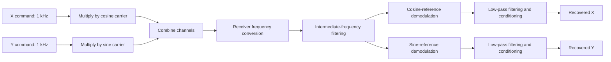

# Analog Quadrature Communication System

**Additional submission files and evidence:** see [Drive submission and evidence](docs/drive-evidence.md) for the separately preserved Drive circuit/report snapshot and available recordings or captures.

A Proteus analog-circuit project exploring transmission of two low-frequency command signals over a shared channel using quadrature modulation, frequency conversion and demodulation.

The design notes describe two **1 kHz input signals**, X and Y, multiplied by **50 kHz cosine and sine carriers**. Their modulated outputs are combined into one signal. The intended receiver translates the received signal to an intermediate frequency, separates the two channels using quadrature references, and filters the recovered outputs.

## Project files

| File | Purpose |
| --- | --- |
| [Proteus project](proteus/quadrature-communication.pdsprj) | Original analog circuit, renamed from `subcircuit2.pdsprj` |
| [Design report](docs/analog-design-report.docx) | Notes on modulation, heterodyning, filters and demodulation |

The original circuit and report contents are preserved. The Proteus project archive passes its internal ZIP integrity check, and its stored design contains AD633 multiplier models and signal generators. This file inspection does not establish correct circuit operation.

## Intended architecture

## Design approach

- **Modulation:** use AD633 analog multipliers for the two orthogonal carrier paths. The report describes using the multiplier's summing input when combining signals.
- **Frequency conversion:** use heterodyning to move the received signal toward the report's target intermediate frequency of 10 kHz.
- **Filtering:** attenuate unwanted mixer products, then low-pass filter the demodulated channels to recover their baseband content.
- **Output conditioning:** the report identifies amplitude restoration and removal of unwanted offsets as receiver goals.

These describe the intended system and the submitted design notes; they are not claims of measured performance. Quadrature recovery also depends on the reference phases and frequency alignment.

## Current verification status

The existing files have been packaged and their copies checked against the originals. No fresh Proteus simulation, waveform capture, hardware build or end-to-end recovery measurement was performed during repository preparation.

The frequency plan needs review before the circuit is treated as validated. In particular, the report's example of 10 kHz and 88 kHz mixer products needs reconciliation with the stated 50 kHz carrier, and a saved receiver-generator frequency is stored as `39` without a `k` suffix. Its intended units and setting should be checked in Proteus. The circuit and original report have not been changed to resolve these points.

## Open and inspect

1. Open `proteus/quadrature-communication.pdsprj` in a compatible Proteus installation with the required AD633 models.
2. Confirm the amplitudes, frequencies and relative phases of the two input signals and carrier references.
3. Inspect the combined signal, mixer output and intermediate-frequency filter output with the simulator's waveform tools.
4. Verify the receiver frequency plan, quadrature phases and filter cutoffs before checking recovered X and Y.
5. Compare recovered channels with the inputs for amplitude, phase, unwanted offsets and channel leakage; save the resulting waveforms.

The required Proteus version has not been established. Proteus software and vendor component libraries are not included.

## Background

Originally developed for a Spider Electronics exercise involving an underwater robot's shared command link. The repository is named after the communication system's function.
