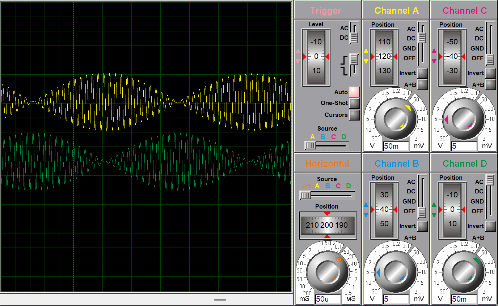
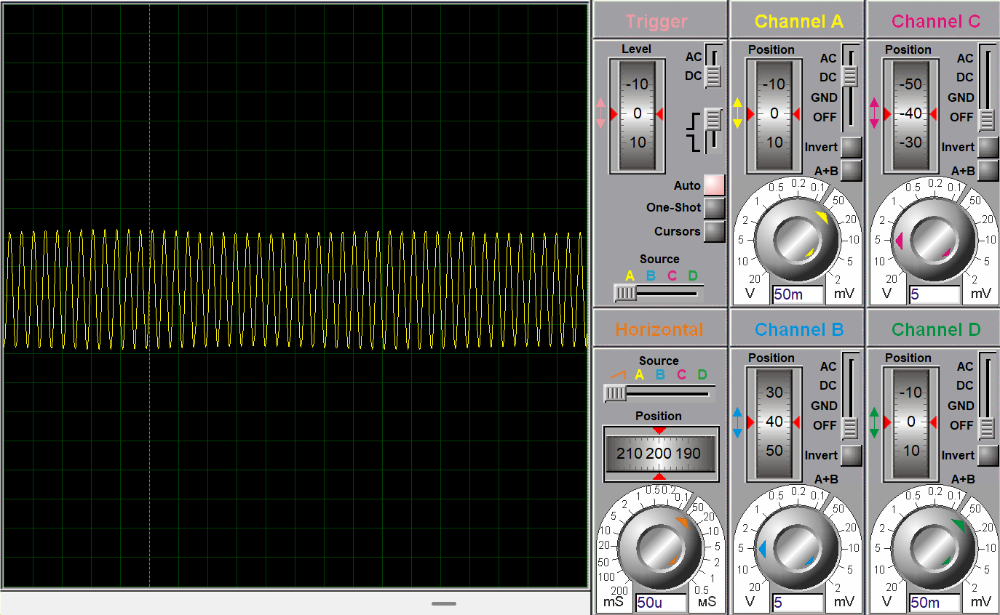
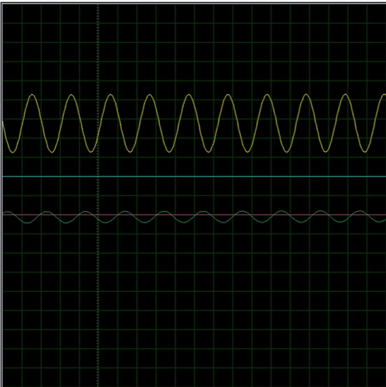

# Drive submission and evidence

Additional material retrieved from the supplied Google Drive folder on 20 October 2026. The previously published local files remain available; the Drive submission is stored separately because its circuit and report contents differ. No final-version ordering has been inferred.

[Source submission folder](https://drive.google.com/drive/folders/1SH889F54DX5ULuKx7baFtpPDh7aIlltt)

## Submitted files

- [subcircuit.pdsprj](../submissions/google-drive/subcircuit.pdsprj)
- [Subcircuits.docx](../submissions/google-drive/Subcircuits.docx)
- [WaveForms.docx](../submissions/google-drive/WaveForms.docx)

## What this adds

The Drive circuit and report differ from the local archive. The WaveForms document is an exported copy of the Google document and supplies existing oscilloscope captures for the modulation, combined-transmission and intermediate-frequency sections. These are historical captures, not a fresh simulation or proof of full X/Y recovery. The Drive circuit also stores the receiver generator setting as `39`; the frequency-plan review noted in the main README still applies.

## Existing waveform captures

Captions follow the section headings in the submitted WaveForms document. No additional numerical measurements are inferred from these images.

### After modulation, before combining the channels

### Combined transmission signal

### Intermediate-frequency reconstruction section

